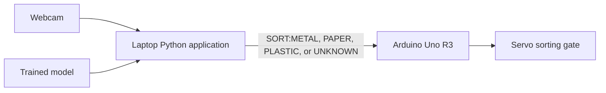

# AI-assisted waste sorter

A beginner-friendly waste-sorting prototype that separates computer vision from physical control.

The current version runs image classification on a laptop and sends compact USB serial commands to an Arduino Uno R3, which moves a servo-operated sorting gate. The project is designed so a later version can move the vision application to an Arduino UNO Q while preserving the proven actuator interface.

## Current capabilities

- Classifies one camera view as **metal**, **paper**, **plastic**, or **unknown**.
- Fine-tunes a small pretrained MobileNetV3-Small model using locally collected images.
- Uses a confidence threshold and three matching frames before issuing a decision.
- Sends plain-text USB commands to an Uno R3.
- Holds the servo at a neutral safe position for `UNKNOWN`, invalid commands, and communication timeouts.

This is an educational prototype. Test first with the servo horn disconnected and use a lightweight dummy object. It is not intended for unattended operation.

## Architecture



The serial protocol is the project boundary: laptop-side software determines the material; the Uno R3 handles the immediate mechanical action. Keeping that protocol stable supports later migration of camera and model processing to Arduino UNO Q.

## Repository layout

```text
arduino/
  uno_sorter/uno_sorter.ino     Uno R3 receiver and servo control
data/
  README.md                     Dataset layout and collection guidance
models/
  README.md                     Locally generated model-output guidance
src/waste_sorter/
  app.py                        Webcam loop and live decisions
  classifier.py                 Model definition, loading, and confidence rule
  serial_protocol.py            USB serial command transport
  train.py                      Fine-tuning program
tests/                          Hardware-free automated checks
pyproject.toml                  Python dependencies and project metadata
```

## What to publish on GitHub

Include the following in the initial repository:

- `README.md`, `.gitignore`, and `pyproject.toml`
- `src/`, `arduino/`, and `tests/`
- `data/README.md` and `models/README.md`

Do not publish your `.venv/` virtual environment, personal training photos, or generated `.pth` model files unless you explicitly have permission to distribute them. The included `.gitignore` excludes these local files.

Before making the repository public, add a `LICENSE` that matches how you want others to use your code. A permissive choice such as MIT is common for learning projects; a license choice should reflect your own intended terms.

## Setup

Install Python 3.10 or newer and Arduino IDE. From the repository root in PowerShell:

```powershell
python -m venv .venv
.\.venv\Scripts\python.exe -m pip install --upgrade pip
.\.venv\Scripts\python.exe -m pip install -e .
```

Using `.venv\Scripts\python.exe` avoids requiring PowerShell activation permissions. If the project has already been installed into your regular Python environment, use `python` in place of the full `.venv` path.

## Dataset and training

Create these local folders, which are intentionally not stored in Git:

```text
data/train/metal/
data/train/paper/
data/train/plastic/
```

Put labeled photos directly in the matching folder. Start with at least 50 varied photos for each category; use examples similar to the expected real objects, angles, distance, lighting, and background. Keep separate photos aside for testing.

Train the model:

```powershell
python -m waste_sorter.train --data data/train --output models/waste_sorter.pth --epochs 8
```

The first training run downloads pretrained MobileNetV3-Small weights. The resulting `models/waste_sorter.pth` is local output, not a universal waste-sorting model. Retrain after adding examples of objects the current model confuses.

## Try the webcam safely

Run without any hardware command being sent:

```powershell
python -m waste_sorter.app --model models/waste_sorter.pth --camera 0 --dry-run
```

Press `q` while the camera window has focus to stop the program. A result below the default 70% confidence threshold becomes `UNKNOWN`; the program requires three consecutive equal decisions before logging or sending a command.

## Arduino Uno R3

Open `arduino/uno_sorter/uno_sorter.ino` in Arduino IDE, select **Arduino Uno**, select its port, and upload.

The servo signal connects to pin 9. Calibrate `PLASTIC_ANGLE`, `PAPER_ANGLE`, `METAL_ANGLE`, and `SAFE_ANGLE` with the servo horn disconnected. Use a suitable regulated servo power supply under load and connect its ground to Uno GND.

The sketch uses serial at 9600 baud and accepts one newline-terminated command:

```text
SORT:METAL
SORT:PAPER
SORT:PLASTIC
SORT:UNKNOWN
```

It replies with `READY`, `ACK:<LABEL>`, or `ERR:<REASON>`. Invalid input and a 10-second command timeout return the servo to its safe angle.

With Serial Monitor closed, connect the live laptop application to the Uno (replace `COM3`):

```powershell
python -m waste_sorter.app --model models/waste_sorter.pth --camera 0 --port COM3
```

## Testing sequence

1. Run `python -m pytest` to check the protocol and confidence logic.
2. Train with local photos and test the webcam using `--dry-run`.
3. Use Arduino Serial Monitor to test each `SORT:` command with the horn disconnected.
4. Test the connected system with the horn disconnected.
5. Fit the horn and test light dummy objects.

## Roadmap

| Version | Compute host | Controller role | Intended work |
|---|---|---|---|
| v0.1 (current) | Laptop | Uno R3 drives one servo | Train a three-class model, test camera, verify safe serial control. |
| v0.2 | Laptop | Uno R3 drives servo and reads simple sensors | Add item-present sensing, clearer status replies, and more reliable mechanical sequencing. |
| v1.0 | Arduino UNO Q | Uno R3 can remain a dedicated actuator controller, or be replaced after validation | Port camera/model application while retaining the `SORT:<LABEL>` protocol and safety behavior. |

The migration principle is simple: keep the labels, confidence policy, and serial protocol stable; only replace the system that produces the decision.

## Dependencies

Python: PyTorch, TorchVision, OpenCV, Pillow, and pySerial. Tests use pytest. Arduino IDE supplies the Servo library used by the Uno sketch.
